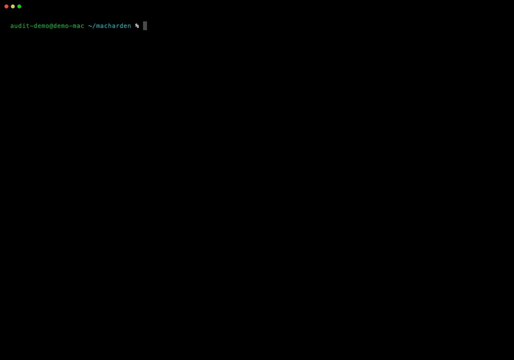
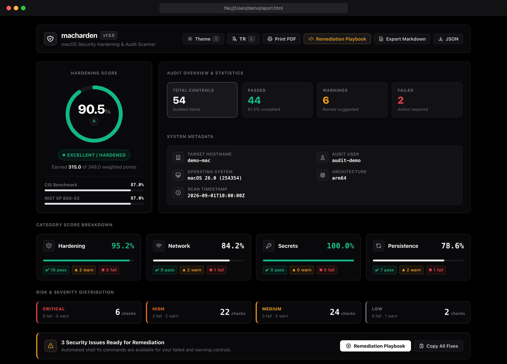

<h1 align="center">macharden</h1>

<p align="center">
  <strong>Read-only macOS security audit with hardening guidance, baseline drift detection and CI gates.</strong><br>
  54 checks mapped to CIS, NIST SP 800-53 and MITRE ATT&amp;CK · zsh · HTML, SARIF, JSON and Markdown reports
</p>

<p align="center">
  <a href="https://github.com/jankesec/macharden/actions/workflows/ci.yml"></a>
  <a href="https://github.com/jankesec/macharden/releases/latest"></a>
  <a href="LICENSE"></a>
  
  
  
</p>

<p align="center">
  
</p>
<p align="center"><sub>Recorded from <code>scripts/demo_fixture.sh</code>: synthetic results rendered by the real report code. The recording never audits the Mac that produced it.</sub></p>

## Why macharden

- **Read-only by default.** A normal audit inspects configuration and changes nothing. Fixes run only when you pass `--fix`, and only typed `[EXEC]` actions can run; `[GUIDE]` items stay manual.
- **Built for macOS.** SIP, FileVault, Gatekeeper, the application firewall, OpenBSM auditing, launchd persistence, BPF permissions, Keychain, SSH and secrets in dotfiles, not generic Unix checks.
- **Made for pipelines.** Baseline drift (`--diff`), exit-code gates (`--fail-on-regression`, `--min-score`, `--fail-on-warn`) and SARIF 2.1.0 for GitHub code scanning.
- **No third-party dependencies.** zsh does the work. The HTML dashboard, SARIF output, `--diff` and compliance tags use the system Python 3 (standard library only).

## Quick start

**Homebrew**

```bash
brew install jankesec/tap/macharden
macharden
```

**Release tarball** (no git needed)

```bash
curl -fsSL https://github.com/jankesec/macharden/archive/refs/tags/v1.5.0.tar.gz | tar xz
cd macharden-1.5.0 && ./bin/macharden
```

**Clone**

```bash
git clone https://github.com/jankesec/macharden.git
cd macharden && ./bin/macharden
```

`make install` adds a symlink, shell completions and the man page (`man macharden`). macharden needs the `lib/` and `data/` directories next to `bin/`, so it cannot be piped from `curl` into a shell.

**Requirements:** macOS 12 or later and zsh. The HTML dashboard, SARIF output, `--diff` and compliance tags also need Python 3 (standard library only), which ships with the Xcode Command Line Tools (`xcode-select --install`).

Your first report:

```bash
macharden -f html -o report.html && open report.html
```

## What it checks

| Domain | Checks | Examples |
|:---|:---:|:---|
| System hardening | 21 | SIP, FileVault, Gatekeeper, screen lock, automatic updates, firmware password, Secure Boot, OpenBSM audit trail |
| Network and perimeter | 12 | Application firewall and stealth mode, BPF permissions, wildcard TCP listeners, AirDrop, Internet Sharing, IP forwarding |
| Secrets, keys and credentials | 11 | API keys in shell profiles, exposed `.env` files, SSH keys and `sshd` configuration, cloud credentials, `PATH` permissions |
| Persistence and daemons | 10 | LaunchAgents and LaunchDaemons, cron, `authorized_keys`, sudoers, privileged helper tools |

[docs/CHECKS.md](docs/CHECKS.md) lists all 54 checks with their CIS, NIST and MITRE identifiers and weights. It is generated from `data/compliance_mappings.json`, the same data the reports use.

## Reports and the dashboard

| Format | Command | Use it for |
|:---|:---|:---|
| Terminal | `macharden` | Interactive review |
| HTML | `macharden -f html -o report.html` | One self-contained dashboard |
| SARIF 2.1.0 | `macharden -f sarif -o results.sarif` | GitHub code scanning and other SAST tools |
| JSON | `macharden -f json -o report.json` | SIEM ingestion and drift baselines |
| Markdown | `macharden -f markdown -o report.md` | Pull requests and tickets |

The format follows the output extension, so `-o report.html` is enough. `-q` prints only the executive summary.

<p align="center">
  
</p>

The dashboard is one HTML file. It loads no scripts, fonts or images from the network; the reference links are plain anchors. It offers:

- filters by domain, framework (CIS, NIST, MITRE), status and severity, plus search (`/`)
- a remediation playbook that you can copy or download as a shell script
- Markdown and JSON export, and print to PDF
- English and Turkish (`L`), dark and light themes (`T`); `Esc` closes dialogs

## CI/CD and drift

```bash
macharden -f json -o baseline.json                    # snapshot a reviewed state
macharden --diff baseline.json                        # show what changed since then
macharden --diff baseline.json --fail-on-regression   # exit 2 when the posture regressed
macharden --min-score 85                              # exit 1 below a Hardening Index of 85
macharden --fail-on-warn                              # exit 1 on any warning
```

| Exit code | Meaning |
|:---:|:---|
| `0` | No check failed and every requested gate passed |
| `1` | A check failed, `--fail-on-warn` or `--min-score` was not met, or the invocation was invalid |
| `2` | `--fail-on-regression` found a regression against the baseline |

Drift report (synthetic data, produced by `scripts/demo_fixture.sh --diff`):

```text
======================================================================
                     BASELINE DRIFT & SECURITY DIFF
======================================================================

  Baseline Scan:     2026-09-01T10:00:00Z (Host: demo-mac)
  Current Scan:      2026-09-15 14:00:00 UTC (Host: demo-mac)
----------------------------------------------------------------------
  Baseline Score:    [████████████████████████████░░]  94.3% (EXCELLENT / HARDENED)
  Current Score:     [███████████████████████████░░░]  90.5% (EXCELLENT / HARDENED)
----------------------------------------------------------------------
  Drift Summary:
    • New Regressions : 4
    • Fixed / Healed  : 1
    • Unchanged       : 49

  ▶ New Security Regressions (4):
  --------------------------------------------------------------------
    [REGRESSION] HARD-18    OpenBSM Security Auditing Daemon Status
                 ↳ Posture : PASS ➔ WARN  (Category: hardening, Weight: 8)
    [REGRESSION] NET-10     IP Forwarding
                 ↳ Posture : PASS ➔ FAIL  (Category: network, Weight: 7)
```

A GitHub Actions workflow that uploads findings to the Security tab:

```yaml
name: macOS security audit
on:
  schedule:
    - cron: '0 0 * * 1'
  workflow_dispatch:

permissions:
  contents: read
  security-events: write

jobs:
  audit:
    runs-on: macos-latest
    steps:
      - name: Install macharden
        run: |
          git clone --depth 1 --branch v1.5.0 https://github.com/jankesec/macharden.git ~/.macharden-tool
          echo "$HOME/.macharden-tool/bin" >> "$GITHUB_PATH"
      - name: Audit
        run: macharden -f sarif -o macharden-results.sarif -q || true
      - uses: github/codeql-action/upload-sarif@v4
        with:
          sarif_file: macharden-results.sarif
          category: macharden-macos
```

## Safety and privacy

- A normal audit only reads local security configuration, and secret findings avoid exposing the detected value.
- `--fix` asks before it changes anything, `--dry-run` previews the commands, `--undo` rolls back the last session, and `--generate-fix` writes a script for review instead of running it.
- Reports contain the host name, user name and OS build. Review or sanitize them before sharing publicly.
- Policy that affects users, such as the Keychain lock timeout, is never imposed silently: a profile selects an organization-defined value or skips the check.

## Tailor a baseline

Copy [`examples/macharden.prf`](examples/macharden.prf), choose values that match the Mac's role and pass it with `--profile`:

```ini
profile-name=Personal Mac
machine-role=personal
keychain-timeout=none
keychain-lock-on-sleep=no
# skip-test=HARD-08
```

```bash
macharden --profile ./developer.prf
```

## How it relates to other tools

- **[macOS Security Compliance Project (mSCP)](https://github.com/usnistgov/macos_security)** is a NIST-hosted project that generates baselines, configuration profiles and compliance scripts. Use it to author and enforce a baseline; macharden is a read-only audit and drift check that runs directly on a Mac or a macOS CI runner without generating anything first.
- **[Lynis](https://cisofy.com/lynis/)** is a security auditing tool for Unix-like systems that also supports macOS. macharden concentrates on macOS subsystems (SIP, FileVault, Gatekeeper, launchd, OpenBSM) and provides SARIF output, an HTML dashboard and drift gates.
- **[CIS-CAT Pro](https://www.cisecurity.org/cybersecurity-tools/cis-cat-pro)** assesses systems against the CIS Benchmarks and is available with a CIS SecureSuite membership. macharden maps its checks to CIS, NIST and MITRE identifiers but is an independent project and does not replace an official benchmark assessment.

<sub>Reviewed in November 2026; check each project's site for its current features.</sub>

## Documentation

- [User guide](docs/USER-GUIDE.md): install, first audit, profiles, reports, remediation, drift, scheduled scans and troubleshooting
- [Security checks reference](docs/CHECKS.md): every check with its CIS, NIST and MITRE identifiers
- [Architecture](docs/ARCHITECTURE.md): runtime flow, scoring model, trust boundaries and remediation contract
- [Manual page](docs/macharden.1): every command and option (`man macharden`)
- [Changelog](CHANGELOG.md) and [security policy](SECURITY.md)

## Development

```bash
make test    # syntax checks, unit tests and mocked audits
make lint    # ShellCheck for the Bash completion, zsh and bash syntax, man page
make docs    # regenerate docs/CHECKS.md from data/ and lib/
make demo    # regenerate the GIF and images (needs vhs, ffmpeg, Google Chrome and Pillow)
```

CI runs on `macos-latest` and `ubuntu-latest`: `zsh -n` on the CLI, libraries, tests and demo fixture, the unit and mock suites, ShellCheck (error severity) on the Bash completion, and on macOS a read-only scan that also generates Markdown, JSON and a remediation script.

## Author

```text
Author          : Sevban Dönmez (@jankesec)
Role            : Senior Cyber Security Consultant · Red Team & Offensive Security Researcher
Research Portal : https://jankesec.com
GitHub          : https://github.com/jankesec
PGP Fingerprint : FF0A 7D83 6751 CCE3 F9CC F574 FCF8 39FB 7F00 4626
GPG Key ID      : 5FDB257F4AAE8C3F
```

<p align="center">
  <a href="https://star-history.com/#jankesec/macharden&Date">
    
  </a>
</p>

## Disclaimer

Use macharden only on systems you own or are authorized to assess. Applying remediation can change system preferences, firewall configuration and background services; review generated scripts before you run them on production Macs. The author assumes no liability for unintended changes or service disruption.

## License

MIT. See [`LICENSE`](LICENSE).

<p align="center">
  <a href="https://www.buymeacoffee.com/sevbandonmez">
    
  </a>
</p>
